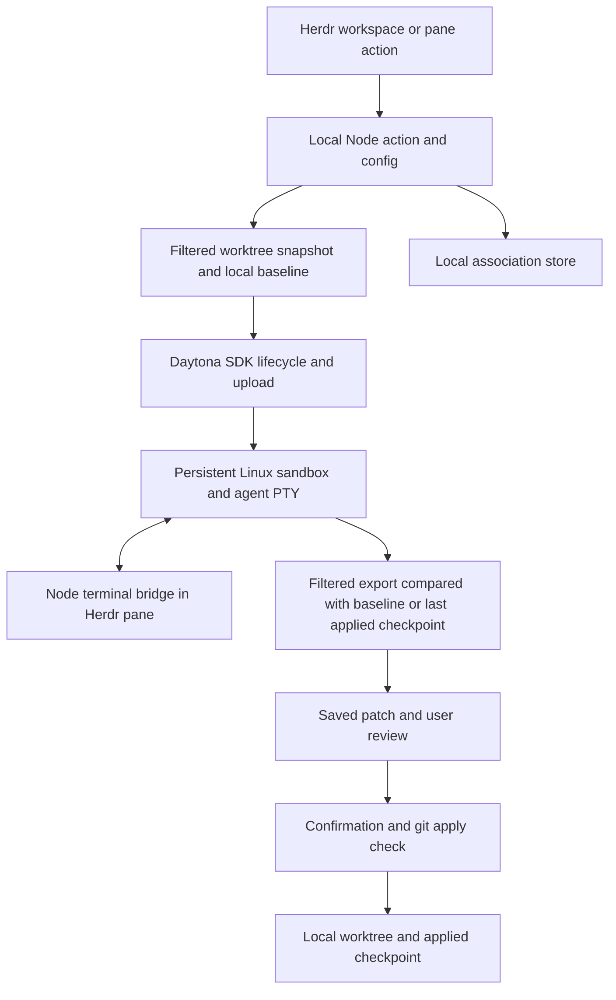

# Herdr Daytona Sandbox Plugin - Plan

## Goal Capsule

- **Objective:** Developers can work with a coding agent remotely from Herdr, return to its saved workspace, and bring reviewed changes into their local worktree.
- **Means:** One persistent Daytona sandbox per agent, with a local terminal bridge and snapshot-relative patch return (KTD1, KTD3, KTD5).
- **Authority:** The user's requirements govern product behavior. Product Contract requirements govern technical decisions and implementation units.
- **Execution profile:** This PR contains the plan only. The user resolved the auto-stop default and requested the existing Herdr plugin conventions. Build the plugin in one subsequent implementation PR.
- **Stop conditions:** Stop and clarify if implementation evidence invalidates a selected design. Do not claim the plugin works until install, terminal attachment, persistence, and patch-return checks pass against real Herdr and Daytona.
- **Completion owner:** The implementing contributor supplies the plugin, test evidence, and install instructions; the user reviews the resulting implementation PR.

---

## Product Contract

### Summary

Create `allagentsdev/herdr-daytona-sandbox`, a public Herdr plugin for Claude Code, Codex, OpenCode, and Pi.
Herdr remains the local terminal and action surface.
Remote edits return through a patch preview and explicit local approval.

### Problem Frame

Developers need isolated compute for coding agents without moving their terminal workflow or granting the remote environment access to their local repository credentials.
They also need to preserve remote work across disconnections and inspect what comes back before changing local files.

### Requirements

**Installation and configuration**

- R1. Ship `herdr-plugin.toml` with ID `daytona.sandbox`, minimum Herdr `0.8.0`, and platforms `linux` and `macos`; expose `start-agent`, `reconnect`, `apply-changes`, `delete-sandbox`, and `status` in appropriate workspace/pane contexts through Node scripts.
- R2. Support `herdr plugin install allagentsdev/herdr-daytona-sandbox` with a reproducible dependency installation hook, and `herdr plugin link` after a documented `npm ci` step. Require Node.js 22+ without requiring a global agent installation locally.
- R3. Read `config.json` from Herdr's plugin config directory. Validate agent kind, an array of literal agent arguments, image or snapshot, region, operation timeouts, auto-stop, upload excludes, and explicit credential-injection settings before allocating compute. Default to Daytona's native 15-minute interval of provider-detected inactivity while retaining sandbox files; stopping ends running agent processes. The interval is configurable.
- R4. Prefer host `DAYTONA_API_KEY` for Daytona control-plane authentication; support explicit SDK JWT plus organization credentials as an alternative. Keep these credentials local and report missing/expired authentication without printing values.

**Remote work and persistence**

- R5. `start-agent` resolves the invoking Git worktree, captures its current files including eligible uncommitted/untracked files, creates a fresh sandbox, and opens a new associated Herdr pane. Independent starts receive independent sandboxes.
- R6. Upload only eligible regular files and executable modes. Exclude `.git`, dependency/cache/build directories, ignored files, known credential paths, `.env` variants, and private keys even when tracked; reject escaping paths and do not dereference symlinks. User excludes add restrictions and cannot remove mandatory exclusions.
- R7. Supply a Linux environment containing Git, Node, a persistent terminal/session mechanism, and the selected agent. Record the agent version used and support all four agent choices without silently substituting another agent.
- R8. Persist sandbox identity, worktree identity, pane/session context, upload baseline identity, and lifecycle phase locally. Losing a pane or transport must not delete the sandbox or overwrite its workspace on reconnect.
- R9. `reconnect` uses the invoking pane's association when present; otherwise it presents retained associations for the current worktree for explicit selection and opens a new associated pane. Resume stopped or archived storage as supported, reattach a running session, and restart the configured agent only when the old process has ended. A process cannot survive a sandbox stop; the filesystem must survive.
- R10. `status` reports local association and provider state without starting stopped sandboxes. Missing worktrees, missing sandboxes, disconnected panes, and uncertain provider requests remain distinguishable.

**Change return and deletion**

- R11. `apply-changes` exports edits relative to the exact uploaded baseline initially and the last successfully applied checkpoint thereafter, including eligible additions, deletions, executable-mode changes, and binary changes. Agent commits must not hide edits, and preexisting local edits must not be replayed as agent work.
- R12. Save and show the exact candidate patch, its changed paths, and its destination before approval. Apply only the reviewed bytes after explicit user confirmation, destination/path checks, and `git apply --check`; abort on conflicting local changes without staging, committing, resetting, or falling back to a three-way merge.
- R13. Reject patches that modify Git metadata, escape the worktree, traverse symlinks, or write mandatory-excluded paths. Treat downloaded content, patch paths, and remote Git metadata as untrusted.
- R14. `delete-sandbox` requires explicit confirmation naming the sandbox. Keep recovery metadata until deletion is confirmed by Daytona. Worktree removal retains the sandbox by default; optional cleanup must be explicitly enabled and must satisfy the same deletion-approval rule.

**Credentials and operations**

- R15. Copy no host credentials by default. Support agent login inside the sandbox and an explicit allowlist of named host environment variables for provider keys; never forward all environment variables or copy agent auth directories. Daytona management credentials are forbidden from that allowlist.
- R16. Emit useful progress, recoverable state, and redacted errors to Herdr. Record sandbox identity as soon as creation succeeds, and leave recoverable resources visible when later setup fails.
- R17. Document installation, each action, all config fields and defaults, authentication, persistence versus running processes, costs/lifecycle settings, excluded-file limitations, and recovery/cleanup.
- R18. Follow existing Herdr sandbox plugin conventions for manifests, action/pane entrypoints, configuration names, state, results/errors, and development checks. Use Blaxel as the concrete baseline where the reference plugins differ, adapting provider behavior to Daytona and preserving R6/R13/R15 safety requirements.

### Acceptance Examples

- AE1. Covers R5, R6, R11: a checkout has an unstaged edit, a new source file, and tracked `.env`. The eligible edit/new file reach the sandbox, `.env` does not, and applying a subsequent agent edit preserves the original local work.
- AE2. Covers R8, R9: after closing an attached pane, invoking reconnect from another pane offers the retained association and reaches the same sandbox and live agent in a new pane. After a sandbox stop/start, files remain and the agent can be started again without a second sandbox.
- AE3. Covers R11, R12: an agent commits changes and creates a binary file. Preview still shows both, cancellation changes nothing locally, and approval applies only a patch that passes local checks.
- AE4. Covers R12, R13: a malicious patch targets `.git/config`, an absolute path, or a symlink leading outside the worktree. The plugin rejects it and writes nothing at the target.
- AE5. Covers R14: removing a worktree or cancelling deletion retains the remote sandbox and enough local metadata to find it.

### Scope Boundaries

V1 provides terminal agents and Linux sandboxes from Linux/macOS hosts.
Desktop, GUI, GPU, Windows images, multi-agent fleets, automatic merges, continuous bidirectional sync, and repository push credentials are outside this version.

Deferred to follow-up: automatic SDK authentication from a Daytona CLI login profile, additional agent adapters, and any background orphan collector.
The SDK and CLI have different authentication resolution; CLI login alone is not a supported SDK credential source (S5).

---

## Planning Contract

### Reference Review

The [Blaxel plugin](https://github.com/blaxel-ai/herdr-blaxel-sandbox-plugin) is the primary reference for Herdr `0.8.0`, Node ESM actions, all four agents, filtered snapshots, local state, and patch return.
Reuse selected provider-independent code only after checking its tests and preserving the MIT notice.
Its automatic host-provider-key forwarding must be replaced to satisfy R15.

The [Vercel plugin](https://github.com/vercel-labs/herdr-vercel-sandbox-plugin) informs terminal-wrapper and lifecycle behavior, but its inspected tree has no license file permitting code reuse.
Use its design as a reference without copying its implementation.
The [E2B plugin](https://github.com/e2b-dev/herdr-e2b-sandbox) supplies a secondary reference for worktree-removal events; its fleet/dashboard scope is unnecessary here.

### Key Technical Decisions

- KTD1. **Use the stable official SDK through a narrow provider module.** Pin `@daytona/sdk` `0.231.1` and lock transitive dependencies; the older proposed `@daytonaio/sdk` name is not the current documented install. Separate lifecycle/files/exec/PTY operations from Herdr actions so tests can exercise provider responses without cloud access. Recheck the pinned release's signatures before implementation; do not use current alpha source as a substitute. Governs R3-R10. Sources: S4, S6.
- KTD2. **Keep management authentication explicit.** Resolve credentials from host environment or explicit plugin configuration references, then construct the SDK client from a trusted local directory so repository `.env` files cannot choose credentials or region. Use explicit API URL/target settings; do not parse undocumented CLI credential storage. No raw API-key field belongs in the example config. Governs R4, R15. Source: S5.
- KTD3. **Use a Node SDK PTY bridge for interactive attachment.** The wrapper forwards terminal bytes, input, resize events, and exit status; it restores raw-terminal state on errors and disconnects without killing the remote session. The stable PTY API starts a shell and has no command option: submit a safely quoted launch wrapper once, using `exec` so session liveness tracks the agent, and never resubmit on reattach. Persist PTY identity and validate create/attach/disconnect with the pinned SDK. Herdr's local wrapper supplies `HERDR_AGENT` using `claude`, `codex`, `opencode`, or `pi`. If the SDK cannot pass the live persistence/reattach check, stop and revise this decision before introducing SSH or another transport. Governs R7-R9. Source: S7.
- KTD4. **Make filesystem persistence explicit.** Create non-ephemeral sandboxes with auto-delete disabled (`autoDeleteInterval: -1`) and wall-clock destruction disabled (`ttlMinutes: 0`), using the pinned SDK's supported fields. Map R3's approved idle-stop default to Daytona's `autoStopInterval`. Allow normal provider archival and resume; archival is not an agent-process continuity promise. Prefer `eu` and fail clearly if unavailable; never silently move an upload to another region. Expose image or snapshot as mutually exclusive inputs, using a Linux Node/Git base with pinned agent installations. Governs R3, R7-R9. Sources: S6, S8, S9. (session-settled: user-approved — chosen over the proposed 30-minute idle stop: align with Daytona's native 15-minute container default.)
- KTD5. **Use a local immutable upload baseline as patch authority.** Build the filtered snapshot once and retain its content manifest/baseline locally. Initialize a separate Git repository remotely, but compute returned changes against the trusted baseline using a fresh isolated comparison index/repository, rather than relying on the agent's `HEAD`, index, ignore rules, hooks, or Git configuration. Filter returned files by R13 and generate a binary-capable patch from the resulting content. Track the last successfully applied remote content locally so repeated application is a no-op and later edits compare against that checkpoint; never advance the checkpoint on cancellation or failure. Governs R6, R11-R13.
- KTD6. **Use durable local associations with action locking.** Namespace mapping keys by Herdr server/session and workspace/pane, plus canonical worktree path and stable local association ID. Store config/state outside the repository with owner-only permissions, atomic updates, and locks for actions on the same association. Persist a local operation ID/provider label before create and reconcile ambiguous creation outcomes before retrying. Status can show retained records after pane/worktree loss; destructive actions never guess between candidates. Governs R8, R10, R14, R16.
- KTD7. **Separate review from mutation.** Action launches use Herdr's supported command/pane context, and a review popup presents the patch and asks for approval after generation. Popups have no `HERDR_PANE_ID`: pass the captured association explicitly and fail without mutation if the UI is busy. Escape terminal control sequences in review text/paths while preserving the original patch bytes. A generic manifest confirmation before export does not count as patch review. When stdin is not interactive, export the review artifact and require a separate invocation identifying that exact artifact and digest; do not treat missing input as consent. Revalidate patch bytes and destination immediately before application. Governs R1, R12-R14.
- KTD8. **Adapt Blaxel's established module boundaries and public config style.** Keep its shared action dispatcher, separate pane entrypoints, flat camelCase config, mapping/state conventions, versioned result envelope, and Node test/check scripts. Retain the five requested actions without importing unrelated dashboards or previews. Daytona's SDK transport, lifecycle/auth fields, and the explicit credential opt-in are provider/task-specific differences. Governs R18. Sources: S1, S10, S12.

### High-Level Technical Design



### Proposed Configuration

Use Blaxel's flat camelCase configuration style, with `agent` defaulting to `codex`, `agentArgs`, `region` defaulting to `eu`, `image` or `snapshot`, `remoteRoot`, and `excludedPaths`.
Use its existing upload-limit names and defaults: `maxFiles` 10,000, `maxFileBytes` 10 MiB, and `maxUploadBytes` 100 MiB. `excludedPaths` contains literal repository-relative file/directory paths, using Blaxel's validation rather than inventing a glob syntax.
Daytona-specific additions are `autoStopInterval` in minutes per R3, `createTimeoutSeconds`, `execTimeoutSeconds`, and `requestTimeoutMs`; task-specific additions are `agentEnvAllowlist` defaulting to empty and `onWorktreeRemoved` defaulting to `retain`.
The config directory comes from Herdr's plugin environment/config-dir contract, not the current repository.
Resolve the checkout from `HERDR_PLUGIN_CONTEXT_JSON`, preferring `worktree.checkout_path`, with validated focused-pane/workspace cwd fallbacks; action cwd is the plugin installation directory.
Open the new pane against the captured source pane using `HERDR_BIN_PATH`, preserve user focus, and perform long provisioning there so progress stays visible.
Use `HERDR_PLUGIN_CONFIG_DIR` and `HERDR_PLUGIN_STATE_DIR` for local storage. Installation runs the manifest's `npm ci --omit=dev` build hook; linking requires the documented preceding `npm ci` because Herdr does not run builds on link.
Agent arguments remain an argv array; remote shell construction quotes each value without interpolation.
Pin installer package/version per adapter and validate required binaries before launch.
Automatic project dependency installation is opt-in because package scripts execute repository code.

### Herdr Plugin Conventions

These are Blaxel's conventions adopted under R18, not a claim that every Herdr plugin uses identical internals.

| Surface | Convention to follow | Daytona adaptation |
| --- | --- | --- |
| Manifest | One `src/action.mjs` dispatcher using `HERDR_PLUGIN_ACTION_ID`, argv-array commands, separate `[[panes]]`, production dependency build hook | Plugin ID `daytona.sandbox`; retain requested action IDs including `status` |
| Pane entrypoints | `start-pane.mjs` and `agent-pane.mjs` use split panes; `operation-pane.mjs` and `confirmation-pane.mjs` use popups | Progress, patch/status, reconnect selection, and typed deletion approval use the corresponding native surface |
| Context and state | `context.mjs` resolves Herdr context; `state.mjs` owns versioned mapping records in Herdr's supplied directories | Store Daytona IDs/region/PTY identity, preserving KTD6's association isolation |
| Domain modules | `adapters.mjs`, `manifest.mjs`, `patch.mjs`, `sandbox.mjs`, with shared `constants.mjs`, `process.mjs`, `result.mjs`, and `terminal-ui.mjs` helpers | Put SDK-specific lifecycle/files/PTY operations behind `sandbox.mjs` |
| Results/errors | `PluginError` codes and versioned result records containing plugin/action/status/timestamp | Emit `DAYTONA_RESULT` with the Daytona plugin ID and redact credentials |
| Local workflow | Node ESM, `node --test`, Prettier, ESLint, `verify:manifest`, and aggregate `npm run check` | Pin the official Daytona SDK; manifest verification covers the requested five actions |

Do not copy Blaxel's `idleDelete` policy: it permanently deletes idle sandboxes, which differs from R3's filesystem-preserving stop.
Its automatic provider-key forwarding and sensitive-path overrides also do not replace the explicit restrictions in R6/R15.

### Constraints and Assumptions

- Snapshot selection is a filename/path policy, not a general-purpose secret scanner. Unknown secrets embedded in ordinary source files can still be uploaded; show the upload summary and document this limit.
- Filter tracked-but-ignored candidates with `git check-ignore --no-index` as well as Git's untracked-file inventory. Bound snapshot/export file counts and bytes with documented configurable limits, checking before upload/download consumes unbounded resources.
- Exclude symlinks, nested repositories, submodule contents, and Git LFS payload retrieval in v1. Report skipped content so users can identify an incomplete project snapshot. LFS pointer files remain ordinary files.
- Reject snapshot races detected between selection and reading; preserve one stable staged upload rather than rereading the live tree for transfer.
- Verify how live SDK terminal activity affects Daytona's idle accounting; the idle-stop policy is resolved, while provider activity semantics remain an implementation check.
- Test with real Daytona only after implementation is authorized. Cloud and provider-agent credentials stay in the host environment or sandbox login flow and never enter repository files or PR artifacts.
- This planning PR contains no runnable plugin and makes no lifecycle-verification claim.

---

## Output Structure

```text
herdr-plugin.toml
package.json
package-lock.json
README.md
LICENSE
THIRD_PARTY_NOTICES.md
config.example.json
src/
  action.mjs
  start-pane.mjs
  agent-pane.mjs
  operation-pane.mjs
  confirmation-pane.mjs
  context.mjs
  constants.mjs
  process.mjs
  result.mjs
  terminal-ui.mjs
  herdr.mjs
  config.mjs
  state.mjs
  sandbox.mjs
  manifest.mjs
  patch.mjs
  adapters.mjs
test/
  actions.test.mjs
  config.test.mjs
  state.test.mjs
  manifest.test.mjs
  sandbox.test.mjs
  agent-pane.test.mjs
  patch.test.mjs
  lifecycle.test.mjs
scripts/
  verify-manifest.mjs
eslint.config.mjs
.prettierrc.json
docs/
  plans/
  verification.md
.github/workflows/ci.yml
```

---

## Implementation Units

### U1. Establish plugin actions, configuration, and local state

**Goal:** Herdr can install/link the plugin, resolve action context, and retain an association safely.
**Requirements:** R1-R4, R8, R10, R16, R18. **Dependencies:** none.
**Files:** `herdr-plugin.toml`, `package.json`, `package-lock.json`, `src/action.mjs`, `src/herdr.mjs`, `src/context.mjs`, `src/config.mjs`, `src/constants.mjs`, `src/process.mjs`, `src/result.mjs`, `src/state.mjs`, `config.example.json`, `LICENSE`, `THIRD_PARTY_NOTICES.md`, `test/actions.test.mjs`, `test/config.test.mjs`, `test/state.test.mjs`.
**Approach:** Mirror Blaxel's supported manifest/build and context contracts. Implement KTD2, KTD6, and action dispatch before provider allocation. Preserve MIT attribution where code is reused.
**Test scenarios:**

- All five action IDs resolve through the manifest and install/link hooks with paths containing spaces.
- Malformed arguments/config, missing management auth, and ambiguous pane mappings fail before compute creation.
- Two Herdr sessions with matching pane IDs retain distinct associations; concurrent state writes cannot corrupt or lose a record.

**Verification:** A clean Herdr installation links and lists the five actions. Tests exercise config/state boundaries; they do not prove live SDK or pane behavior.

### U2. Capture a filtered worktree and trusted baseline

**Goal:** Uploads represent eligible on-disk work without carrying local Git metadata or known credentials.
**Requirements:** R5, R6, R11, R15; AE1. **Dependencies:** U1.
**Files:** `src/manifest.mjs`, `test/manifest.test.mjs`.
**Approach:** Build one local staged snapshot and content manifest per KTD5, before sandbox creation. Use Git's NUL-delimited path inventory, apply mandatory/user filters, and preserve executable modes.
**Test scenarios:**

- Covers AE1: a linked worktree with unstaged/staged changes, untracked files, and tracked secrets produces the expected snapshot without changing its local index.
- Ignored dependencies, nested `.git` files/directories, private keys, submodules, and internal/escaping symlinks are excluded.
- Filenames with spaces/newlines, empty files, and binary data survive capture; a file replaced during capture fails safely.

**Verification:** Inspect the actual generated snapshot from temporary Git repositories. These tests prove the selection/baseline boundary, not Daytona transfer integrity.

### U3. Create and prepare persistent Daytona sandboxes

**Goal:** Start allocates one recoverable sandbox and prepares the selected agent with explicit lifecycle/auth settings.
**Requirements:** R3-R8, R15, R16. **Dependencies:** U1, U2.
**Files:** `src/sandbox.mjs`, `src/adapters.mjs`, `src/start-pane.mjs`, `src/action.mjs`, `test/sandbox.test.mjs`, `test/lifecycle.test.mjs`.
**Approach:** Implement KTD1/KTD4. Upload the staged snapshot via binary-safe SDK filesystem APIs and initialize the remote work directory. Persist lifecycle phases and IDs before the next provider operation. Agent installation and credentials follow R7/R15.
**Test scenarios:**

- Each configured agent selects its own pinned installer and literal arguments; no ambient provider keys are forwarded.
- EU unavailability, bad image/snapshot, auth failure, and interrupted setup produce clear errors and retained association information.
- A timed-out create is reconciled by operation label before retry; upload/setup failure does not create another sandbox.
- A real Linux sandbox receives byte-identical files, starts the chosen agent, and retains its workspace after stop/start.

**Verification:** Provider fakes prove orchestration and explicit parameters. A live SDK run proves creation/transfer/persistence; it is required before claiming U3 complete.

### U4. Attach, reconnect, report status, and delete

**Goal:** A Herdr pane provides an interactive terminal with reliable association and explicit deletion.
**Requirements:** R8-R10, R14, R16; AE2, AE5. **Dependencies:** U3.
**Files:** `src/agent-pane.mjs`, `src/operation-pane.mjs`, `src/confirmation-pane.mjs`, `src/terminal-ui.mjs`, `src/herdr.mjs`, `src/action.mjs`, `src/state.mjs`, `test/agent-pane.test.mjs`, `test/lifecycle.test.mjs`.
**Approach:** Implement KTD3/KTD6/KTD7. Register the worktree-removal hook for retention/orphan marking; an optional cleanup flow requests approval rather than deleting from an event without interaction.
**Test scenarios:**

- Covers AE2: raw input, Unicode, resize, Ctrl-C, transport loss, pane closure, and reattach reach the same session without duplicated agent processes. Invoking reconnect from an unassociated pane offers retained associations; selecting one creates a mapped pane, and cancelling changes nothing.
- Stopped/archived sandbox reconnect restores files and starts one agent when needed; status does not wake it.
- Covers AE5: cancelled deletion and removed worktrees retain resources; approved deletion removes only the selected sandbox, with failed/uncertain deletion retaining its record.

**Verification:** Local terminal tests prove byte/signal cleanup. Real Herdr panes plus Daytona prove interactive attachment, focus preservation, detection metadata, and detach semantics.

### U5. Review and apply remote changes

**Goal:** Users inspect and approve agent edits while preserving local work.
**Requirements:** R11-R13; AE1, AE3, AE4. **Dependencies:** U2, U3, U4.
**Files:** `src/patch.mjs`, `src/action.mjs`, `test/patch.test.mjs`, `test/lifecycle.test.mjs`.
**Approach:** Implement KTD5/KTD7 using Git subprocesses with hooks/config isolated from remote content. Use real temporary local repositories to exercise validation and application.
**Test scenarios:**

- Covers AE1/AE3: dirty starting files, agent commits, additions/deletions, executable changes, and binary edits return only agent changes relative to the baseline/checkpoint.
- Cancel, non-interactive invocation, stale/tampered patch artifacts, destination replacement, and overlapping local edits make no unintended local writes.
- Covers AE4: excluded paths, absolute/traversal paths, symlink escapes, remote `.git` tampering, and malicious Git config/hooks cannot change files outside the approved destination.
- Applying the same remote result twice is a no-op; a later agent edit applies once, and a failed apply does not advance the checkpoint.

**Verification:** Tests invoke actual `git apply --check`/apply in disposable repositories and compare resulting files/index. A live round-trip from an agent pane proves the complete review flow.

### U6. Document and verify the installable plugin

**Goal:** A new user can install, configure, use, reconnect, and clean up the plugin from documented instructions.
**Requirements:** R1-R18. **Dependencies:** U1-U5.
**Files:** `README.md`, `docs/verification.md`, `.github/workflows/ci.yml`, `package.json`, `eslint.config.mjs`, `.prettierrc.json`, `scripts/verify-manifest.mjs`, `test/actions.test.mjs`.
**Approach:** Explain defaults and exclusions, manual login/explicit credential injection, CLI-auth limitations, lifecycle costs, and orphan recovery. Keep CI cloud-free and record live evidence separately.
**Test scenarios:**

- Fresh dependency install and `herdr plugin link` resolve scripts without relying on the contributor's cwd or global npm packages.
- A published/review branch can be installed through Herdr's supported GitHub/ref install syntax; verify final default-branch install after merge.
- All four agents have real startup evidence, with terminal/reconnect and patch round-trip coverage on the supported host platforms. Record exact host/Herdr/SDK/agent/image versions and any unverified matrix entries.

**Verification:** User-facing commands match the tested CLI versions; CI passes and documented live evidence satisfies the contract below.

---

## Verification Contract

No production implementation or cloud tests run in this planning PR.
The implementation follows Blaxel's `npm run check`: `npm run format:check`, `npm run lint`, `npm run verify:manifest`, and `npm test` using Node's test runner. Run it after a clean `npm ci` on Linux and macOS with Node 22.
Networked tests remain explicit opt-in checks and do not run on ordinary pull requests.

Before calling the plugin working, record:

1. Install/link against Herdr `0.8.0` and the current supported release; if the APIs require a newer minimum, revise R1 with the user before release.
2. Real start and interactive startup for Claude Code, Codex, OpenCode, and Pi. Installing a binary or checking its version alone does not establish interactive support.
3. Live detach/reconnect without creating another sandbox, then stop/start persistence and agent restart. Check archive recovery where available, distinguishing untested behavior.
4. Snapshot transfer and reviewed patch round-trip from a dirty linked worktree, including agent commits, cancellation, conflicts, and repeated application.
5. Explicit deletion and retained-worktree-removal behavior, with redacted logs and no secret values in evidence.

Mocks establish local action orchestration and failure behavior; they cannot establish terminal persistence, authentication, provider lifecycle semantics, or Herdr screen detection.
If provider credentials, agent login, host platforms, or a documented capability are unavailable, name the gap and leave the corresponding completion criterion open.

---

## Definition of Done

The five actions satisfy R1-R18, each implementation unit passes its stated verification, and the live matrix has evidence for all four agents.
The plugin installs/links from the documented source and supports a complete reviewed change round-trip.
No inherited credential forwarding or unlicensed Vercel code remains.
Dependency locks, attribution, examples, and README agree with the tested implementation.
Remove abandoned experiments before review and retain enough state to locate any sandbox created during validation.

---

## Sources

- S1. [Blaxel plugin source](https://github.com/blaxel-ai/herdr-blaxel-sandbox-plugin), inspected at `a6669e9fc367eba98bcff0aa5c972c4993e94def`: manifest, actions, agents, snapshot/change-return patterns, and MIT license.
- S2. [Vercel plugin source](https://github.com/vercel-labs/herdr-vercel-sandbox-plugin/tree/be8393aac17eae4b67ca58fdcc5ad8233f91b6c5): manifest and terminal/lifecycle design; verify licensing before any future code reuse.
- S3. [E2B plugin manifest](https://github.com/e2b-dev/herdr-e2b-sandbox/blob/be667cc20a66a0771580d4a7d0e80c813d3ed78e/herdr-plugin.toml): worktree event integration.
- S4. [Official Daytona TypeScript SDK](https://www.daytona.io/docs/en/typescript-sdk/) and [stable SDK package metadata](https://registry.npmjs.org/@daytona/sdk/0.231.1): package name, stable version, runtime API.
- S5. [Daytona authentication](https://www.daytona.io/docs/en/authentication/): environment/config versus CLI profiles, JWT organization context, and repository `.env` loading.
- S6. [Daytona create parameters](https://www.daytona.io/docs/en/typescript-sdk/daytona/): image/snapshot, target, lifecycle intervals, TTL, operation timeouts.
- S7. [Daytona process/PTY API](https://www.daytona.io/docs/en/typescript-sdk/process/): create/connect/list/resize/kill PTY sessions and disconnect handling.
- S8. [Daytona sandboxes and regions](https://www.daytona.io/docs/en/sandboxes/): EU target and sandbox lifecycle.
- S9. [Daytona persistence](https://www.daytona.io/docs/en/persistence/): retained files versus process state.
- S10. [Herdr 0.8.0 plugin authoring contract](https://github.com/herdrdev/herdr/blob/346411fa21afd297f5ed3b3fa56f9e3fbf7654b7/website/src/content/docs/plugins.mdx): manifests, build hooks, pane/popup launch, and environment/context.
- S12. [Blaxel config](https://github.com/blaxel-ai/herdr-blaxel-sandbox-plugin/blob/a6669e9fc367eba98bcff0aa5c972c4993e94def/src/config.mjs), [manifest](https://github.com/blaxel-ai/herdr-blaxel-sandbox-plugin/blob/a6669e9fc367eba98bcff0aa5c972c4993e94def/herdr-plugin.toml), [package scripts](https://github.com/blaxel-ai/herdr-blaxel-sandbox-plugin/blob/a6669e9fc367eba98bcff0aa5c972c4993e94def/package.json), and [result/error envelope](https://github.com/blaxel-ai/herdr-blaxel-sandbox-plugin/blob/a6669e9fc367eba98bcff0aa5c972c4993e94def/src/result.mjs): concrete conventions adopted under R18.
- S11. [Stable Daytona SDK source](https://github.com/daytona/clients/tree/779af21af54cf31ba7b0baaaa006fac463e04ad9/sdk-typescript): v0.231.1 implementation, especially `Daytona.ts`, `Process.ts`, `PtyHandle.ts`, `types/Pty.ts`, and `utils/Runtime.ts`.

Provider docs were checked on 2026-11-16. Recheck the stable package's source at implementation time when docs and alpha source differ.
